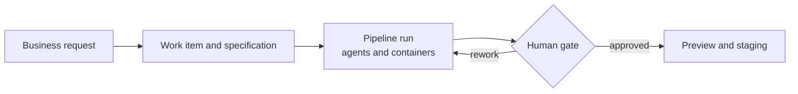

<p align="center">
  
</p>

# Kodama

**An open-source, API-first software factory for Kubernetes. Coding agents and container pipelines do the work; people make the decisions.**

[](https://github.com/optimiware/kodama/actions/workflows/ci.yml)
[](LICENSE)
[](go.mod)

Kodama turns a business request into reviewed, deployed software. It connects a request to a specification, a working branch, a pipeline run, evidence and a deployment, and it stops at the points where an accountable human has to say yes.

It is built for teams that write software to fill the gaps in their ERP, CRM and legacy systems, and want less dependence on disconnected SaaS products.

> **Status: early.** The core platform runs end to end on a developer machine, verified against real PostgreSQL, JetStream, S3, Git and Podman. It is not production-ready yet. See the [project status](docs/status.md) for what works and what doesn't.



## What a pipeline looks like

A pipeline is a versioned file. Agents and ordinary containers are steps, and a gate waits for a person (abridged from the [full example](docs/examples/workflows/erp-gap-to-preview.md)):

```yaml
apiVersion: kodama/v1alpha1
kind: Pipeline
metadata:
  name: inventory-preview
spec:
  steps:
    - id: implement                # an agent writes the change on the work item's branch
      kind: agent
      agent: {profile: coding-v1}
      workspace: {access: write, from: run}

    - id: test                     # an ordinary container checks it
      kind: container
      needs: [implement]
      image: registry.example.invalid/go-tools@sha256:1111…
      command: ["/bin/sh", "-ec"]
      args: ["cd /workspace && ./ci/quality.sh"]
      workspace: {access: read, from: implement}
      outputs:
        report: {type: artifact, path: /kodama/outputs/quality.json}

    - id: review                   # a person decides, looking at that evidence
      kind: gate
      needs: [test]
      gate:
        evidence: ["${{ steps.test.outputs.report }}"]
```

## Why Kodama

- **API-first.** Everything is available through the HTTP API, a generated Go client and the CLI, so it fits the editors and tools you already use.
- **Small core.** One Go server, one step entrypoint, a handful of durable records, and ordinary Git and container commands.
- **Recoverable.** Source you published and results you committed survive container and server failures. Retries and cancellation are durable.
- **Humans accept.** Agents produce evidence. People accept business outcomes.
- **Safe by default.** Tenant and project scope travel through data, execution, events and artifacts. Secrets are KMS-encrypted and write-only through the API.

## The pieces

- A **work item** captures intent, acceptance criteria and business progress.
- A **workspace** pairs an actionable work item with a Git branch. Commits are durable checkpoints.
- A **pipeline run** executes a versioned workflow and records evidence.
- A **gate** asks one accountable human to decide, based on identified source and evidence.
- A **blueprint** provides stack-specific conventions, templates and agent guidance.

Reference lifecycle: story → plan → specification → prototype → implementation → QA gate → build → preview → staging → E2E tests → AI exploratory QA → human review → done. Each project picks the stages it needs.

## Built with

Go for the server, Kubernetes Jobs for pipeline steps, PostgreSQL for state and encrypted secrets, NATS JetStream for events, Git for source and S3-compatible storage for artifacts and logs. It targets AWS, GCP and Scaleway, and one installation serves several tenants in separate namespaces. See the [architecture](docs/book/05-system-architecture.md).

## Try it

```sh
make test-m1     # the whole first slice in memory: no containers, about 30 seconds
make build       # builds dev/.state/bin/kodama
dev/.state/bin/kodama --help
```

Running the real server needs PostgreSQL, JetStream, S3, Git and an OIDC issuer. The [development runbook](dev/README.md) brings them up locally with Podman. You need Go 1.27.2 and GNU Make.

## Documentation

- [Project status](docs/status.md)
- [Vision and scope](docs/book/01-vision-and-scope.md) and [roadmap](docs/book/07-delivery-roadmap.md)
- [Domain and lifecycles](docs/book/03-domain-and-lifecycles.md)
- [System architecture](docs/book/05-system-architecture.md)
- [Reference workflow](docs/examples/workflows/erp-gap-to-preview.md)
- [Installation design](docs/operations/installation-and-configuration.md)
- [All documentation](docs/README.md)

Kodama is the agent layer of Optimi Platform, which owns shared tenant identity and core services. Kodama owns agent execution and the software-delivery lifecycle within that authority, and also runs standalone. See [platform integration](docs/specs/platform-integration.md) and the [Optimi documentation](https://optimi.com/en/docs/kodama).

## Contributing

Contributions are welcome. Start with [CONTRIBUTING.md](CONTRIBUTING.md).

## License

Apache License 2.0. See [LICENSE](LICENSE).
