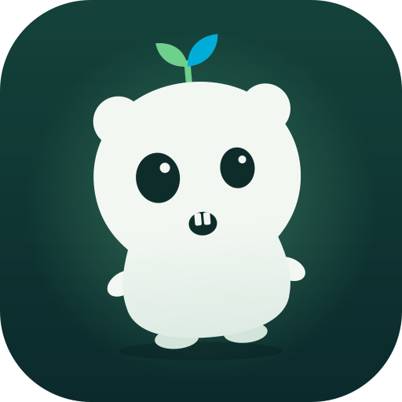

<p align="center">
  
</p>

<h1 align="center">Kodema</h1>

<p align="center">
  <strong>Run coding agents as a team, at enterprise scale, on your own Kubernetes</strong>
</p>

<p align="center">
  <sub><strong>The wood remembers</strong></sub>
</p>

<p align="center">
  <em>Unseen, the wood thinks<br>
  branches commit while you sleep<br>
  dawn finds the leaves changed</em>
</p>

<p align="center">
  <a href="https://github.com/optimiware/kodema/actions/workflows/ci.yml"></a>
  <a href="https://github.com/optimiware/kodema/releases"></a>
  <a href=".go-version"></a>
  <a href="LICENSE"></a>
</p>

Kodema is an open-source software factory for engineering organizations. It
takes a task to a tested, merged change: a coding agent does the work in a
container, the people you choose approve it, and all of it runs on the
Kubernetes cluster you already operate.

A coding agent in a terminal serves one developer on one laptop. A company has
hundreds of repositories, people who start work and others who must review it,
and teams that must never see each other's code. Kodema is built for that
shape:

- **Any harness.** Claude Code, Codex, OpenCode, Pi or a shell script is a
  container command. Kodema gives each of them the same workspace, task,
  credential and model access, so changing harness changes an image, not the
  pipeline or its rules.
- **Enterprise scale.** Multi-tenant, role-based and audited. Each action is a
  plain Kubernetes Job, so capacity is your cluster's, and work that waits for
  a person holds a volume and no CPU.
- **People where you choose.** A pipeline can ask a role for a decision. The
  Git service refuses a push to a protected branch without a passed review of
  that exact commit.
- **Yours.** Apache-2.0, written in Go, self-hosted. Your code, pipelines and
  decisions stay in your cluster and your database.

> A pipeline is an ordered list of actions; an action runs a container or
> requests an answer; an execution runs a pipeline once; a task is a
> conversation that starts executions.

## One contract for every harness

Kodema has no plugin per agent. A harness is an image and a command, and every
container action is given the same things:

| A harness needs | Kodema provides |
|---|---|
| The code | `/workspace`, shared by the actions of one execution and kept across approval waits. |
| The task | `/kodema/task.json`, the task's conversation, with the inputs and the outputs of earlier actions as files. |
| An identity | `/kodema/secrets/KODEMA_TOKEN`, an execution credential that is revoked while the execution waits for a decision and when it ends. |
| A model | The optional model proxy. The harness points `ANTHROPIC_BASE_URL` or `OPENAI_BASE_URL` at Kodema and sends the execution credential as its API key; the provider key stays in the control plane. |
| A person | A question on its task, addressed to a role or a service. The reply starts a fresh execution with the whole conversation. |

```yaml
inputs: [repository, target_ref, expected_base]
actions:
  - name: implement
    image: registry.example.com/coding-agent@sha256:…   # the harness is this image
    outputs: [candidate]
    commands:
      - implement-and-push
  - name: test
    image: registry.example.com/test-tools@sha256:…
    commands:
      - test-candidate "$(cat /kodema/outputs/implement/candidate)"
  - name: review
    request: role/reviewer
    timeout: 72h
    subject:
      operation: git.ref.update
      resource: {from: inputs.repository}
      ref: {from: inputs.target_ref}
      candidate: {from: implement.outputs.candidate}
      expected_base: {from: inputs.expected_base}
```

Each action names its own image, so one pipeline can implement with one
harness and check the result with another. The review, the Git rules and the
audit trail do not depend on which harness ran.
[KODEMA.md](KODEMA.md#environment-and-materialized-files) has the contract in
full, and [external-harness.yaml](examples/pipelines/external-harness.yaml) is
the recipe for model access.

## Built for enterprise scale

| A company needs | What Kodema does |
|---|---|
| Teams that cannot see each other | A tenant is an isolated organization: a business unit, a subsidiary, a customer. The boundary is drawn again at every layer: forced row-level security in PostgreSQL, a namespace with a default-deny network policy per tenant on Kubernetes, a derivation key per tenant for credentials, and Git workers and volumes per tenant. |
| Its own sign-in and roles | People sign in through your OIDC provider. Five roles (Admin, Engineer, Reviewer, Operator, Viewer) are granted per tenant and per project, and a role change applies on the next call. The Admin role grants no review authority. |
| Control over what agents merge | Access rules live in a Git repository, in the spirit of gitolite. Per repository and per branch, a person decides, a program decides, or nobody does. |
| Secrets that stay secret | Values are envelope-encrypted under a key in your cloud KMS. The management API returns metadata, never a value. A container gets a secret as a file, and only if its action declares it. |
| To say what ran, and who allowed it | One function authorizes every operation. A decision keeps its actor and time. An execution keeps the exact pipeline bytes it was admitted with, their SHA-256 and the image digests. |
| Capacity for thousands of tasks | An execution is a row in PostgreSQL and its work is Kubernetes Jobs, with no CRDs and no operator. Your scheduler and autoscaler decide how many run at once. |
| To survive a failure | PostgreSQL records facts and NATS only distributes them, so a broker outage delays integrations and does not stop executions. After a crash the controller observes what it had started; it never reruns a command it cannot prove did not run. |
| To install it like everything else | One Helm chart for the control plane, and OpenTofu roots for Scaleway, AWS and Google Cloud that create the cluster, managed PostgreSQL and the KMS key. |

The [production deployment guide](docs/runbooks/production-deployment.md) has
the procedure for your own cluster.

## Status

The current version is in [`VERSION`](VERSION). The changes and known
limitations of each version are in [CHANGELOG.md](CHANGELOG.md). Kodema is
young, and the design is ahead of the evidence in these places:

- The control plane and the NATS broker each run as one replica. An upgrade of
  the control plane is a short outage.
- Scaleway is the only cloud on which a deployment has run. The AWS and Google
  Cloud deployments are implemented and have not been validated on a real
  cloud.
- The reference deployment is a starting point, not a sizing guarantee:
  load-test your own mix of work.
- Isolation is around ordinary containers, for teams that trust their own
  engineers. It is not a sandbox for untrusted code.

## Quick start

On Linux with rootless Podman 5:

```sh
curl -fsSL https://raw.githubusercontent.com/optimiware/kodema/master/install.sh | sh
kodema up
source ~/.kodema/instances/default/env.sh
```

The first line installs `kodema` and `kodactl` into `~/.local/bin`.
[install.sh](install.sh) downloads them from the latest release for your
system and checks them against the release's `SHA256SUMS`. `kodema up` then
starts a complete local Kodema. Run a pipeline file on it:

```sh
podman pull docker.io/library/alpine:3.24@sha256:0f49f331d9212aff11b932863be4eb01cdf962969aa86dab7d1ee21ac6f5f52b
cat > hello.yaml <<'EOF'
actions:
  - name: hello
    image: docker.io/library/alpine@sha256:0f49f331d9212aff11b932863be4eb01cdf962969aa86dab7d1ee21ac6f5f52b
    timeout: 2m
    commands:
      - echo "hello from a Kodema workload"
EOF
kodactl run hello.yaml
```

```text
execution execution-a917c44ec73787377abaf074c6b6b61f started
hello from a Kodema workload
execution execution-a917c44ec73787377abaf074c6b6b61f succeeded
```

The [quickstart](docs/runbooks/quickstart.md) continues with approvals, tasks,
sign-in, Git and MCP.

### Other ways to install

Without the script: download the `kodema` and `kodactl` archives for your
system and `SHA256SUMS` from the
[latest release](https://github.com/optimiware/kodema/releases/latest), then:

```sh
sha256sum --check --ignore-missing SHA256SUMS    # macOS: shasum -a 256 --check --ignore-missing SHA256SUMS
tar -xzf kodema_*.tar.gz && tar -xzf kodactl_*.tar.gz
install -m 0755 kodema_*/kodema kodactl_*/kodactl ~/.local/bin/
```

From a checkout, with Go: `make build` builds `bin/kodema` and `bin/kodactl`;
see the [quickstart](docs/runbooks/quickstart.md#from-a-checkout).

### The Podman bundle

The Podman bundle is a second single-host installation, with a separate
identity provider; the release smoke test runs on it. It installs the released
image (Podman 5, `git` 2.44, `jq`, `openssl`, `curl`, `socat`):

```sh
git clone --branch v0.2.1 https://github.com/optimiware/kodema && cd kodema
podman pull ghcr.io/optimiware/kodema/kodema:0.2.1
KODEMA_LOCAL_KODEMA_IMAGE=ghcr.io/optimiware/kodema/kodema:0.2.1 ./deploy/podman/install.sh
```

Then follow the [Podman bundle runbook](docs/runbooks/podman-quickstart.md) to
[run a first pipeline](docs/runbooks/podman-quickstart.md#run-a-first-pipeline).

## Documentation

| Document | Contents |
|---|---|
| [KODEMA.md](KODEMA.md) | The product specification and acceptance criteria. It governs on conflict. |
| [docs/README.md](docs/README.md) | Detailed specifications and runbooks. |
| [docs/runbooks/quickstart.md](docs/runbooks/quickstart.md) | A local Kodema with `kodema up`, and a first pipeline with `kodactl run`. |
| [docs/runbooks/podman-quickstart.md](docs/runbooks/podman-quickstart.md) | The Podman bundle: the single-host test installation the release smoke runs on. |
| [docs/runbooks/production-deployment.md](docs/runbooks/production-deployment.md) | Deployment on Kubernetes (Scaleway, AWS, GCP). |
| [docs/runbooks/release.md](docs/runbooks/release.md) | How a version is built and published. |

## Repository layout

| Path | Contents |
|---|---|
| `cmd/kodema` | The server binary: `up`, `server`, `git`, `auth`, `agent`, `services`, `migrate`, `bootstrap-admin`. |
| `cmd/kodactl` | The command-line client. |
| `api`, `client` | The public API declarations and the Go client. |
| `internal` | The Kernel, the Shell and Userland. |
| `deploy` | The image, the Helm charts, the Podman bundle and the OpenTofu roots per cloud. |
| `examples` | Example pipelines and knowledge files. |
| `test` | Contract, component, integration, e2e and qualification suites. |

## Build and test

The Go version is pinned in [`.go-version`](.go-version).

```sh
make build    # bin/kodema and bin/kodactl, stamped with the version and revision
make image    # the container image of this checkout, which `kodema up` starts
make check    # gofmt, vet, unit tests, race tests, architecture and docs checks
make dist     # dist/: kodema and kodactl archives, Helm chart packages, SHA256SUMS (needs helm)
```

The suites that need real infrastructure (Podman, kind, the stage) are
described in
[docs/runbooks/unified-test-suite.md](docs/runbooks/unified-test-suite.md).

## The name

Kodema takes its name from the kodama (木霊), a tree spirit of Japanese folklore:
it lives in a tree and is seldom seen. The haiku above says what this one does.
Pipelines and agents commit to branches while you are away, and when you return
you find the result, and whatever waits for your approval.

Ours is a gopher, because Kodema is written in Go. The mascot is inspired by
the [Go gopher](https://go.dev/blog/gopher), designed by Renee French and
licensed under CC BY 4.0. The icon and the social preview are in
[docs/assets](docs/assets).

## License

Apache-2.0. See [LICENSE](LICENSE).
