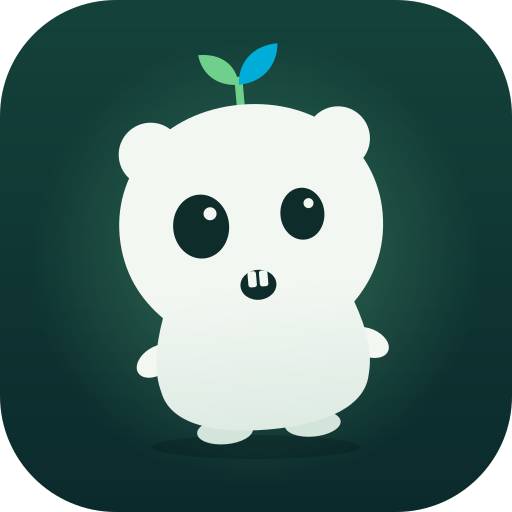

<p align="center">
  
</p>

<h1 align="center">Kodama</h1>

<p align="center">
  <sub><strong>The wood remembers</strong></sub>
</p>

<p align="center">
  <em>Unseen, the wood thinks<br>
  branches commit while you sleep<br>
  dawn finds the leaves changed</em>
</p>

<p align="center">
  <a href="https://github.com/optimiware/kodama/actions/workflows/ci.yml"></a>
  <a href="https://github.com/optimiware/kodama/releases"></a>
  <a href=".go-version"></a>
  <a href="LICENSE"></a>
</p>

Kodama is an API-first, multi-tenant software factory. Engineers configure
projects, pipelines, credentials and guidance; users submit tasks. Container
pipelines, agents and ordinary tools produce source changes, tested artifacts
and deployed software. Humans answer questions and approve candidates through
a role inbox.

A pipeline is an ordered list of actions; an action runs a container or
requests an answer; an execution runs a pipeline once; a task is a
conversation that starts executions.

## Status

The current version is in [`VERSION`](VERSION). The changes and known
limitations of each version are in [CHANGELOG.md](CHANGELOG.md).

## Quick start

On Linux with rootless Podman 5 and Go, from a checkout:

```sh
git clone https://github.com/optimiware/kodama && cd kodama
make build image
bin/kodama up
source ~/.kodama/instances/default/env.sh
```

That starts a complete local Kodama. Run a pipeline file on it:

```sh
podman pull docker.io/library/alpine:3.24@sha256:0f49f331d9212aff11b932863be4eb01cdf962969aa86dab7d1ee21ac6f5f52b
cat > hello.yaml <<'EOF'
actions:
  - name: hello
    image: docker.io/library/alpine@sha256:0f49f331d9212aff11b932863be4eb01cdf962969aa86dab7d1ee21ac6f5f52b
    timeout: 2m
    commands:
      - echo "hello from a Kodama workload"
EOF
bin/kodactl run hello.yaml
```

```text
execution execution-a917c44ec73787377abaf074c6b6b61f started
hello from a Kodama workload
execution execution-a917c44ec73787377abaf074c6b6b61f succeeded
```

The [quickstart](docs/runbooks/quickstart.md) continues with approvals, tasks,
sign-in, Git and MCP.

### The Podman bundle

The Podman bundle is a second single-host installation, with a separate
identity provider; the release smoke test runs on it. It installs the released
image (Podman 5, `git` 2.44, `jq`, `openssl`, `curl`, `socat`):

```sh
git clone --branch v0.2.0 https://github.com/optimiware/kodama && cd kodama
podman pull ghcr.io/optimiware/kodama/kodama:0.2.0
KODAMA_LOCAL_KODAMA_IMAGE=ghcr.io/optimiware/kodama/kodama:0.2.0 ./deploy/podman/install.sh
```

Then follow the [Podman bundle runbook](docs/runbooks/podman-quickstart.md) to
[run a first pipeline](docs/runbooks/podman-quickstart.md#run-a-first-pipeline).

## Documentation

| Document | Contents |
|---|---|
| [KODAMA.md](KODAMA.md) | The product specification and acceptance criteria. It governs on conflict. |
| [docs/README.md](docs/README.md) | Detailed specifications and runbooks. |
| [docs/runbooks/quickstart.md](docs/runbooks/quickstart.md) | A local Kodama with `kodama up`, and a first pipeline with `kodactl run`. |
| [docs/runbooks/podman-quickstart.md](docs/runbooks/podman-quickstart.md) | The Podman bundle: the single-host test installation the release smoke runs on. |
| [docs/runbooks/production-deployment.md](docs/runbooks/production-deployment.md) | Deployment on Kubernetes (Scaleway, AWS, GCP). |
| [docs/runbooks/release.md](docs/runbooks/release.md) | How a version is built and published. |

## Repository layout

| Path | Contents |
|---|---|
| `cmd/kodama` | The server binary: `up`, `server`, `git`, `auth`, `agent`, `services`, `migrate`, `bootstrap-admin`. |
| `cmd/kodactl` | The command-line client. |
| `api`, `client` | The public API declarations and the Go client. |
| `internal` | The Kernel, the Shell and Userland. |
| `deploy` | The image, the Helm charts, the Podman bundle and the OpenTofu roots per cloud. |
| `examples` | Example pipelines and knowledge files. |
| `test` | Contract, component, integration, e2e and qualification suites. |

## Build and test

The Go version is pinned in [`.go-version`](.go-version).

```sh
make build    # bin/kodama and bin/kodactl, stamped with the version and revision
make image    # the container image of this checkout, which `kodama up` starts
make check    # gofmt, vet, unit tests, race tests, architecture and docs checks
make dist     # dist/: kodactl archives, Helm chart packages, SHA256SUMS (needs helm)
```

The suites that need real infrastructure (Podman, kind, the stage) are
described in
[docs/runbooks/unified-test-suite.md](docs/runbooks/unified-test-suite.md).

## The name

A kodama (木霊) is a tree spirit of Japanese folklore: it lives in a tree and
is seldom seen. The haiku above says what this one does. Pipelines and agents
commit to branches while you are away, and when you return you find the
result, and whatever waits for your approval.

Ours is a gopher, because Kodama is written in Go. The mascot is inspired by
the [Go gopher](https://go.dev/blog/gopher), designed by Renee French and
licensed under CC BY 4.0. The icon and the social preview are in
[docs/assets](docs/assets).

## License

Apache-2.0. See [LICENSE](LICENSE).
