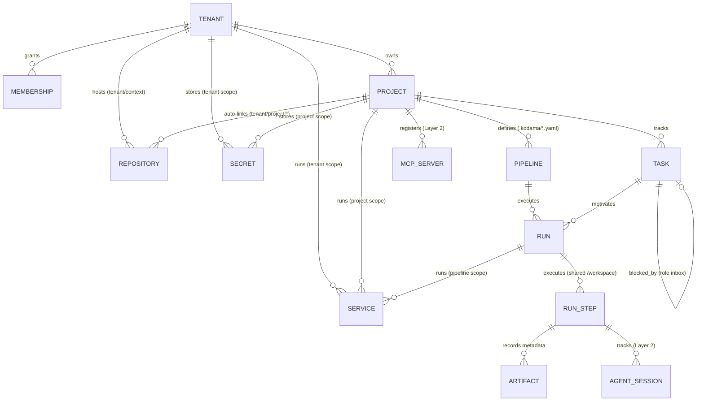
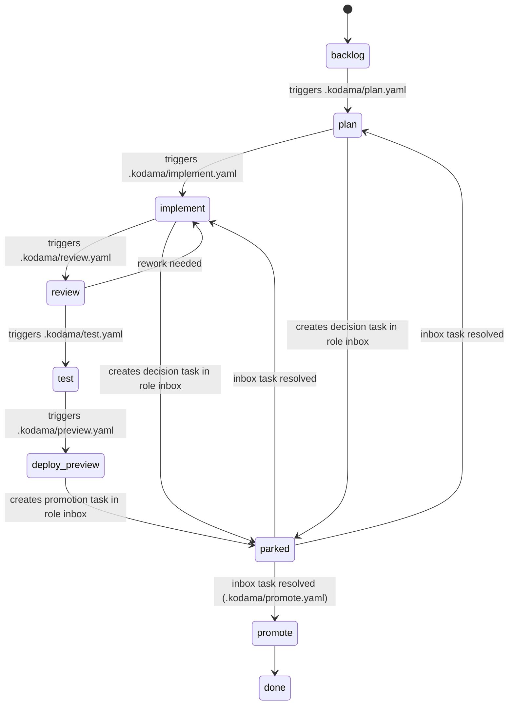

# 3. Domain and lifecycles

Use the [glossary](../../CONTEXT.md) for terms and [database schema](../implementation/database-schema.md) for persistence.

## Core entity hierarchy

At the core, Kodama's relational domain model is **15 tables** (14 domain tables plus audit/outbox) spanning Identity, Layer 1 (Core Primitives), and Layer 2 (Agentic Factory):

## Resource lifecycles

| Resource | States | Authority |
| --- | --- | --- |
| **Task** | Project-defined in `projects.task_workflow` (default: `backlog`, `plan`, `implement`, `review`, `test`, `deploy_preview`, `promote`, `done`, `parked`, `cancelled`) | [Task tracker](../specs/work-management.md) |
| **Run** | `queued`, `running`, `succeeded`, `failed`, `cancelled` | [Pipeline execution](../specs/pipeline-execution.md) |
| **Step (`run_step`)** | `pending`, `running`, `succeeded`, `failed`, `skipped`, `cancelled` | [Pipeline execution](../specs/pipeline-execution.md) |
| **Service** | `starting`, `ready`, `failed`, `stopped` | [Pipeline execution](../specs/pipeline-execution.md) |
| **Agent session** | `running`, `completed`, `parked`, `failed`, `cancelled` | [Agent runtime](../specs/agent-runtime.md) |

## Task state machine and Role Inbox

Each project defines its task state machine in `projects.task_workflow` (stored in PostgreSQL), mapping states and transitions to `.kodama/<processname>.yaml` pipelines via NATS events:

The diagram illustrates workflow behavior. In the Phase 2 model, parking preserves the business state and sets `parked_at`, `blocked_by_id` and `resume_state`. Inbox states are project-defined. Resolution records an explicit outcome; an applicable approval or clarification answer can resume the task, while rejection cannot promote it. See the [task specification](../specs/work-management.md).
