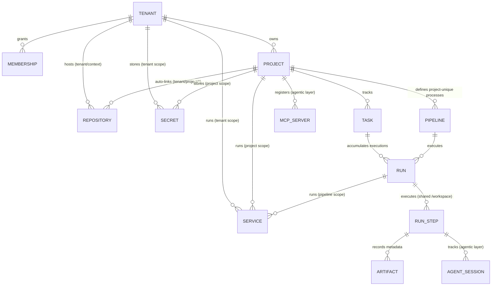
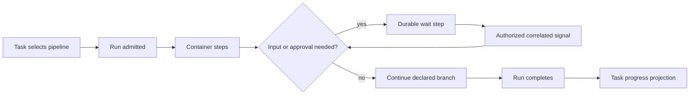

# 3. Domain and lifecycles

Use the [glossary](../../CONTEXT.md) for terms and [database schema](../implementation/database-schema.md) for persistence.

## Core entity hierarchy

Kodama's relational model spans identity, the pipeline-runtime kernel, the native shell, and agentic services. The current executable baseline has 16 product tables; the [simplification plan](../implementation/pipeline-runtime-simplification.md) removes duplicate workflow state without claiming a table reduction from that change alone.

## Resource lifecycles

| Resource | States | Authority |
| --- | --- | --- |
| **Task** | Execution projection: pending, queued, running, waiting, succeeded, failed, cancelled; task content has its own optimistic version | [Task tracker](../specs/work-management.md) |
| **Run** | `queued`, `running`, `succeeded`, `failed`, `cancelled` | [Pipeline execution](../specs/pipeline-execution.md) |
| **Step (`run_step`)** | `pending`, `running`, `waiting`, `succeeded`, `failed`, `skipped`, `cancelled` | [Pipeline execution](../specs/pipeline-execution.md) |
| **Service** | `starting`, `ready`, `failed`, `stopped` | [Pipeline execution](../specs/pipeline-execution.md) |
| **Agent session** | `running`, `completed`, `waiting`, `failed`, `cancelled` | [Agent runtime](../specs/agent-runtime.md) |

## The pipeline owns process progression

A project owns project-unique pipelines. A task selects one pipeline, and that pipeline describes the task's process: planning, implementation, review, test, deployment, rework, and human waits. There is no separate project workflow, transition graph, or state-to-pipeline trigger map.

A task may accumulate several runs through explicit reruns or rework. One run is its current execution. Run and step records own execution truth; the task's status, current step, waiting assignment, and result are a rebuildable projection.

A wait pauses the same run without holding a worker or running a command. The kernel persists the wait identity, expected input, accepted result, deadline, and continuation position. The shell authorizes the actor and records the input against that exact run, step, and wait. The pipeline determines whether the outcome approves, rejects, or requests rework. A role inbox is a query over current waits; it is not a second task lifecycle.

Workspace and run-scoped services have explicit bounded lifetimes during a wait. Loss of required state fails the run rather than replaying earlier commands. A successful signal delivery is not approval by itself.

## Native shell and external behavior

Native Git, tasks, identity, persistence, API/MCP/CLI, and NATS form the shell around the kernel. Git stores source history and knowledge; PostgreSQL stores authoritative state; NATS carries committed events, signals, and triggers. Agentic sessions, harnesses, and gateways are Layer 3. Delivery, rollback, QA, and notification behavior belongs to pipeline recipes, scripts, and container images in Layer 4.

See [ADR 0013](../adr/0013-two-layer-architecture-and-domain-simplification.md) and the [pipeline-runtime simplification plan](../implementation/pipeline-runtime-simplification.md).
