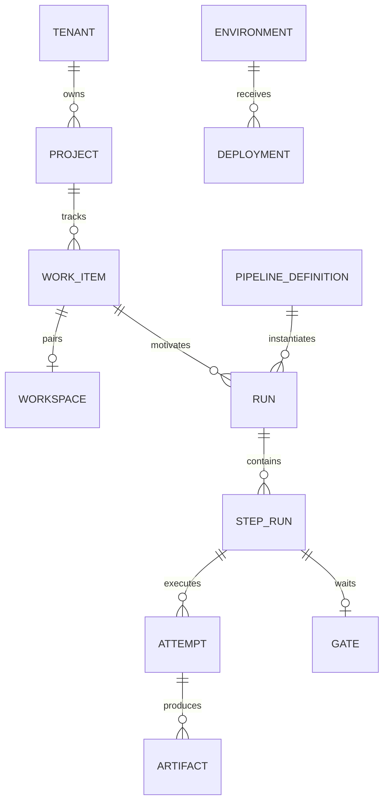
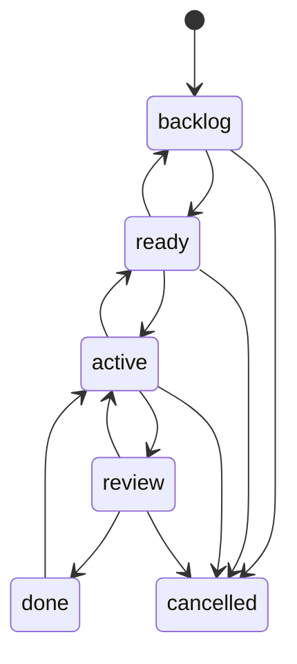

# 3. Domain and lifecycles

Use the [glossary](../../CONTEXT.md) for terms and [schema sketch](../implementation/database-schema.md) for persistence. Work item, workspace, run, and review are separate lifecycles.

Source checkpoints/candidates are Git commits, not separate storage aggregates. Under the designed `run_shared` model a run also owns disposable **run resources** (one shared scratch `/workspace`, preparation, support services, a network boundary); they are execution bookkeeping with their own evidence, not a lifecycle status, an aggregate or a checkpoint ([run resources](../contracts/run-resources.md)). Evidence is artifact metadata/provenance. An agent profile expands into an ordinary executable step. A defect is a work item. A plan is part of the specification.

## States

| Resource | Persisted status | Authority |
| --- | --- | --- |
| Work item | `backlog`, `ready`, `active`, `review`, `done`, `cancelled` | [Work management](../specs/work-management.md) |
| Workspace | `provisioning`, `available`, `archived` | [Workspaces](../specs/workspaces.md) |
| Run | `queued`, `running`, `succeeded`, `failed`, `cancelled` | [Execution](../specs/pipeline-execution.md) |
| Step | `pending`, `running`, `succeeded`, `failed`, `skipped`, `cancelled` | Execution |
| Attempt | `running`, `succeeded`, `failed`, `cancelled` | Execution |
| Gate | `pending`, `approved`, `rejected` | [Delivery](../specs/delivery-and-quality-gates.md) |
| Deployment | `pending`, `running`, `succeeded`, `failed` | Delivery |

Waiting, startup, timeout, unknown outcome, cancellation request, expiry, and deletion use reasons/timestamps. They are not additional status enums. This preserves uncertainty instead of hiding it behind an assumed success/failure.

All entries to active check WIP capacity. Completion is a human decision against current content/source. A passing run does not move the card automatically. A failed run leaves the work branch and published commits available. A gate wait retains a database record without a Job; in the current `attempt_private` model it retains no compute, while in `run_shared` the run's services and scratch persist through the wait, bounded by the run's total deadline.

Content revision changes only when specification/acceptance changes; resource version changes on every mutation. Runs pin content revision and source commit. Gates additionally bind evidence and deployment configuration. Historical runs/decisions remain immutable after rework.
