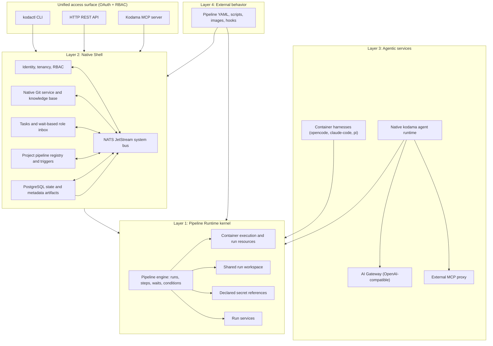

# 5. System architecture

## Functional layers

Kodama is a four-layer system ([ADR 0013](../adr/0013-two-layer-architecture-and-domain-simplification.md)) running alongside Optimi Platform ([platform integration](../specs/platform-integration.md)):

These are dependency boundaries, not four mandatory deployments. The kernel has no dependency on SQL, NATS, HTTP, Git hosting, tasks, identity, or agents. Concrete adapters and the server composition sit outside it.

## Single binary, clean roles

One static Go binary (`kodama` / `kodactl`) provides:

- `kodama server`: the native shell, selected runtime adapter, pipeline engine workers, API, Kodama MCP server, and event consumers.
- `kodama git serve`: per-tenant native Git smart-HTTP worker (`git http-backend`, receive/upload-pack, hooks) over the tenant's repository volume.
- `kodama step`: thin in-container wrapper that prepares the workspace, injects authorized secret references, runs step commands, and reports outputs.
- `kodama agent`: Layer 3 native agent runtime for planning, filtering, guardrails, Git operations, knowledge lookup, and requesting pipeline waits.
- `kodactl`: user, operator, and in-container CLI.

The [pipeline-runtime simplification plan](../implementation/pipeline-runtime-simplification.md) records the pending convergence to one server composition. `--assembly core` and `--assembly kernel` are transitional compositions, not the target architecture.

## Responsibilities

| Component | Responsibility |
| --- | --- |
| **Pipeline Runtime kernel** | Executes pipeline definitions as runs and steps: durable progression, container launch/observation, shared workspace, run services, declared secret delivery, waits, cancellation, deadlines, recovery, logs, and outputs. |
| **PostgreSQL** | Authoritative shell state with tenant RLS: identity, projects, project-unique pipelines, tasks and execution projections, runs, steps, services, secrets, artifacts, Git metadata, audit/outbox, and agentic records. |
| **NATS JetStream** | Central shell bus carrying committed events, execution observations, external signals, Git triggers, and monitoring subscriptions. |
| **Native Git service** | Hosts code and Markdown knowledge repositories under `<tenant>/context` and `<tenant>/<project>/*`; indexes `.kodama/<processname>.yaml` at exact commits. |
| **Container runtime** | Runs kernel workloads through Process (`development`), Podman (`test`), or Kubernetes (`production`) adapters. |
| **KMS / keyfile** | Wraps encryption keys for secrets (cloud KMS in `production`; local keyfile or ephemeral wrapper in `test`/`development`). |
| **External registries and targets** | Store published production artifacts; Kodama records metadata and digests in `artifacts`. Delivery behavior lives in pipeline recipes. |

## Permission model

1. **User RBAC (`memberships`):** external OAuth/OIDC authenticates users; roles (`admin`, `engineer`, `reviewer`, `operator`, `viewer`) control what a user can configure or resolve in a tenant or project.
2. **Project-space workload access:** a step or agent running in a project receives scoped run authority for resources provisioned in that project space (Git repositories, knowledge base, declared secrets, run services, tasks, and gateways), isolated from other tenants.
3. **Current authority:** membership, run liveness, wait assignment, and integration eligibility are re-read when an action occurs. A historical event or cached task field does not grant new access.

## Delivery and operation

The chart and environment select concrete adapters. Deployed `test` and `production` profiles require PostgreSQL, NATS, and the selected runtime; `production` refuses development and test adapters at construction. See [environments](../specs/software-design.md#environments), the [development runbook](../../dev/README.md), and [assembly status](../implementation/assembly-status.md).
