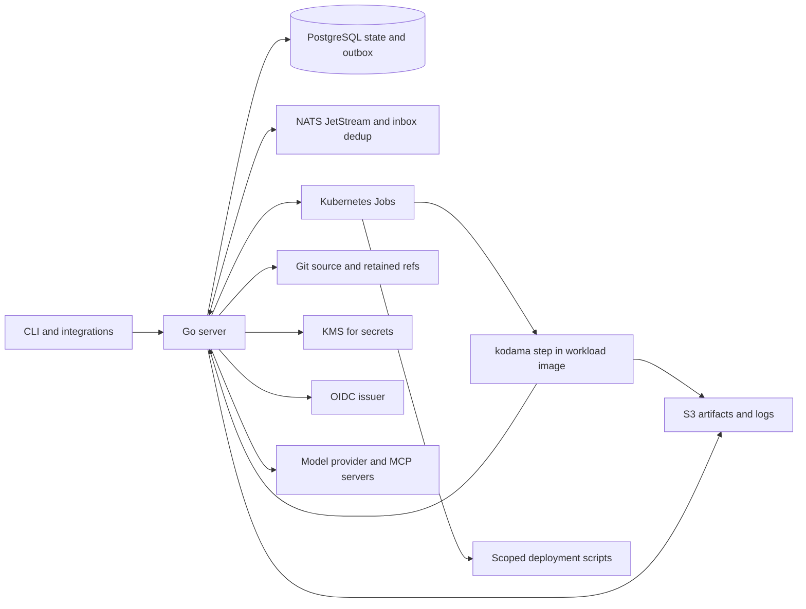

# 5. System architecture

## Company core and agent layer

Optimi Platform owns company-core tenant authority and domain operations. Kodama owns the agent/SDLC lifecycle for those tenants. In hosted operation, narrow adapters resolve current core authority and invoke supported core operations; standalone installations explicitly supply local identity/credential adapters. See [platform integration](../specs/platform-integration.md) for the ownership table, reviewed upstream baseline, current gaps, and acceptance.

The topology below describes Kodama's execution subsystem and local dependency profile. It does not select company-wide database/process colocation or prove a hosted platform connection. Core integration and untrusted-code isolation are separate qualification boundaries.

## Small deployment, explicit state

One Go binary provides `kodama server`, `kodama step`, and user CLI commands. The server hosts API, reconciliation, event publication/consumption, and enabled gateways. Start with one server replica; database claims allow additional replicas without creating separate product services.

The [package layout](../implementation/repository-layout.md) defines modules within this process. Each module owns its state transitions and failure behavior; a module is not a separate deployment requirement.

Hosted core adapters implement consumer-owned ports at composition; they do not query platform tables or ingestion streams directly. Platform jobs and Kodama runs retain distinct lifecycle owners and explicit correlation rather than competing retry loops.

## Preferred internal design

Prefer a lightweight hexagonal ports-and-adapters design with DDD entities. Module-owned entities protect business invariants and transitions; application use cases coordinate them through small consumer-owned ports. HTTP/CLI/event adapters invoke use cases, and PostgreSQL/Git/Kubernetes/provider adapters implement outbound ports. `internal/app` wires concrete implementations; dependencies point inward so domain entities remain independent of transport and infrastructure. See the [software design specification](../specs/software-design.md) for scope, transaction/RLS obligations, and acceptance.

## Environments

One required variable, `KODAMA_ENV`, selects the adapters behind the same ports ([ADR 0009](../adr/0009-environments.md), [environments](../implementation/environments.md)). `development` is purely in memory with the Process runtime and exists for fast tests and the loopback developer server. `test` runs PostgreSQL, JetStream, S3, Git, OIDC and a registry on Podman with the Podman runtime and no cluster. `production` is Kubernetes: kind for conformance, then the stage cluster. `production` refuses development and test adapters.

## Responsibilities

| System | Authority |
| --- | --- |
| PostgreSQL | Kodama work/history, run/attempt/gate state, project configuration, artifact/deployment metadata, outbox/inbox; standalone identity/credential state or explicit hosted projections under the core contract |
| NATS JetStream | Durable asynchronous event delivery, redelivery, and notifications |
| Git | Published source checkpoints and per-run retained commits |
| S3-compatible storage | Reports, transcripts, images of test results, retained logs; temporary bundle transfer |
| OCI registry | Built image manifests/blobs addressed by digest |
| Kubernetes | Actual workload execution and observed Job/Pod state |
| KMS | Required. Wrapping KEKs for scope keys; Go derives per-revision value keys |

No shared writable source volume is required. Attempts use private clones. Publication passes through a control-plane Git writer using expected-tip CAS; a database row alone does not fence a remote writer. See [workspaces](../specs/workspaces.md).

## Dispatch and completion

1. API commits run/input snapshot and outbox event.
2. Publisher durably publishes to JetStream; a crash may cause duplicate delivery.
3. Consumer deduplicates local effects; the reconciler also periodically scans nonterminal state.
4. A short transaction claims an eligible attempt and writer/capacity. External Kubernetes calls occur afterward.
5. The runtime (Kubernetes in staging and production) creates/observes a deterministic Job with `backoffLimit: 0` and injected `kodama step`.
6. Entrypoint admits, clones, executes, collects outputs, and requests source publication where applicable.
7. Result verification commits final state/evidence/outbox. Gates retain pending records without Pods.

A Job is not an exactly-once guarantee. Unknown outcomes remain explicit until observed or resolved. External scripts use stable action keys; deployment rows precede apply. [Runtime contract](../implementation/step-entrypoint.md) and [event contract](../contracts/event-catalog.md) define the seams.

## Installation and isolation

Helm installs the server and configuration on Kubernetes. AWS, GCP, and Scaleway are the supported clouds. PostgreSQL and that cloud's KMS are required; NATS, Git, S3, registry, and OIDC are declared integrations. Development pins a local keyfile instead of a cloud KMS. Kubernetes live log access and retained log artifacts work without Loki; operators can add Loki for aggregation.

O-07 starts with mutually trusting tenant engineers on regular Kubernetes containers, using tenant namespaces, RLS, scoped credentials, restricted Pods, network policies and quotas. gVisor, Substrate and other isolation/security options are deferred extensions requiring their own qualification. The current trusted-engineer scope does not wait for those backends. On-premises/hosted authority contracts remain shared; execution trust and supported capacity are declared separately.
