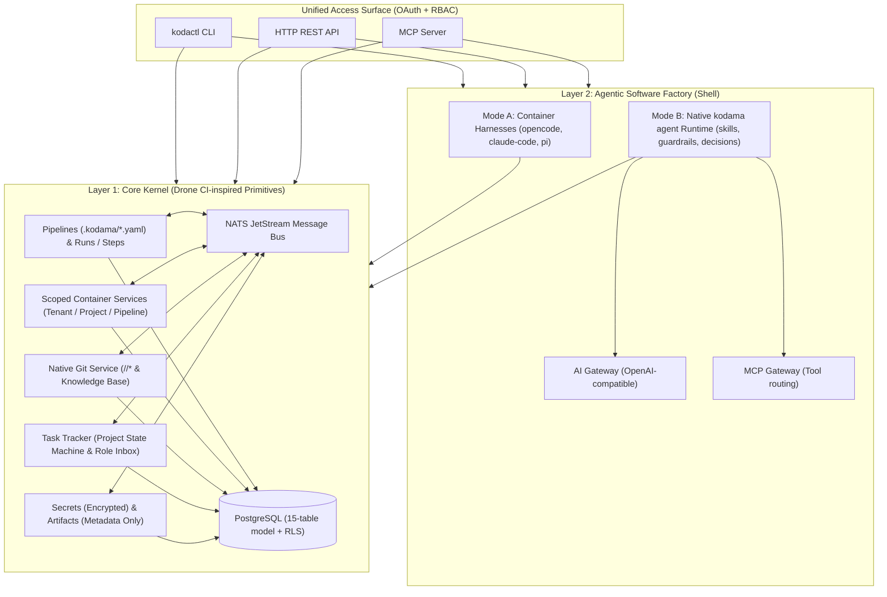

# 5. System architecture

## Functional layers

Kodama is structured as a two-layer system ([ADR 0013](../adr/0013-two-layer-architecture-and-domain-simplification.md)) running alongside Optimi Platform ([platform integration](../specs/platform-integration.md)):

## Single binary, clean roles

One static Go binary (`kodama` / `kodactl`) provides:
- `kodama server`: HTTP API, MCP server, pipeline/service scheduler, NATS consumers, AI Gateway, and MCP Gateway.
- `kodama git serve`: Per-tenant native Git smart-HTTP worker (`git http-backend`, receive/upload-pack, hooks) over the tenant's repository volume.
- `kodama step`: Thin in-container wrapper that prepares/mounts `/workspace`, injects authorized secrets, runs step commands, and reports outputs.
- `kodama agent`: Native Layer 2 agent runtime for planning, filtering, guardrails, validation, Git operations, knowledge-base lookup, and task state transitions.
- `kodactl`: User, operator, and in-container CLI.

## Responsibilities

| Component | Responsibility |
| --- | --- |
| **PostgreSQL** | 15-table relational store with tenant RLS (`tenants`, `users`, `memberships`, `projects`, `repositories`, `pipelines`, `runs`, `run_steps`, `services`, `tasks`, `artifacts`, `secrets`, `agent_sessions`, `mcp_servers`, `audit_events`). |
| **NATS JetStream** | Internal message bus capturing and relaying Git push/tag/merge triggers, task state transitions, step/agent coordination signals, releases, and promotions. |
| **Native Git service** | Hosts code and Markdown knowledge-base repositories under `<tenant>/context` and `<tenant>/<project>/*`; auto-indexes `.kodama/<processname>.yaml`. |
| **Container runtime** | Runs pipeline steps (`run_steps`) with a shared `/workspace` and support `services` (scoped to tenant, project, or pipeline) on Kubernetes (`production`), Podman (`test`), or Process (`development`). |
| **KMS / Keyfile** | Wraps encryption keys for `secrets` (AWS KMS, GCP Cloud KMS, or Scaleway Key Manager in `production`; local keyfile in `test`/`development`). |
| **External registries & targets** | Store published production artifacts (OCI images, packages, bundles); Kodama tracks metadata and digests in `artifacts`. |

## Permission model

1. **User RBAC (`memberships`):** External OAuth/OIDC authenticates users; roles (`admin`, `engineer`, `reviewer`, `operator`, `viewer`) control what a user can configure or resolve in a tenant or project.
2. **Project-space workload access:** Any step or agent running in a project is issued a scoped run token granting access to the resources provisioned and configured in that project space (the project's Git repositories, tenant/project knowledge base, mounted secrets, scoped services, tasks, and gateways) while isolating it from other tenants.
